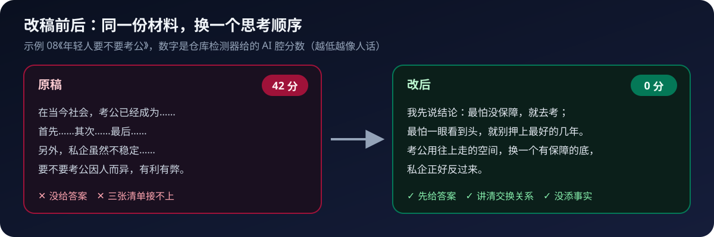

<div align="center">


# Denken wie Wang Ziru

**Erst die Antwort, dann klar der Grund, und es hält auch Nachfragen stand. Ein Satz an deine KI genügt: Sie analysiert eine Frage, schreibt ein Skript, überarbeitet deinen Text oder spricht ein Thema mit dir gründlich durch.**

[](#)
[](#)
[](#)
[](#sieh-dir-zuerst-an-was-es-schreibt)
[](CHANGELOG.md)
[](LICENSE)
[](.github/workflows/ci.yml)
[](tools/)
[](corpus/)
[](CONTRIBUTING.md)

[](https://github.com/chrislitality-svg/think-like-wangziru/commits/main)

[简体中文](README.md) · [English](README.en.md) · [한국어](README.ko.md) · [日本語](README.ja.md) · [Français](README.fr.md) · **Deutsch**

</div>

## Sieh dir zuerst an, was es schreibt

Jeder Text unten ist die vollständige Ausgabe, die die KI nach einem einzigen Satz mit diesem Skill geliefert hat. Die Beispiele sind auf Chinesisch; öffne sie, um den ganzen Text und die verwendeten Vorgehensweisen zu lesen.

| Nutzung | Dein Satz | Ein Satz aus dem Ergebnis | Volltext |
|---|---|---|---|
| 🔍 Analysieren | Lohnt sich ein Programmierkurs für mein Kind noch? | Wenn der Kurs vor allem Syntax auswendig lernen und den Code des Lehrers abtippen lässt, lohnt er sich heute nicht mehr. Wenn er beibringt, ein großes Problem in kleine Schritte zu zerlegen, lohnt er sich weiterhin, und je stärker die KI wird, desto mehr. | [Beispiel 05](examples/05-分析-孩子要不要学编程.md) |
| 🔍 Analysieren | Lohnt sich jetzt ein Falt-Smartphone? | Wie oft du es aufklappst, entscheidet mehr über den Wert als die Tiefe der Falte. | [Beispiel 09](examples/09-分析-现在买折叠屏值不值.md) |
| 🔍 Analysieren | Ich habe Geld übrig. Soll ich meinen Immobilienkredit vorzeitig tilgen? | Erst ein Polster behalten, dann Zinsen sparen. Nicht umgekehrt. | [Beispiel 11](examples/11-分析-要不要提前还房贷.md) |
| ✍️ Schreiben | Ein 2-Minuten-Skript: Warum so viele gespeicherte Tipps dich nicht besser gemacht haben | Das Speichern belohnt dich im Voraus für „das lerne ich noch“. Du hast nichts gelernt, fühlst dich aber schon so. | [Beispiel 06](examples/06-写稿-收藏了那么多干货为什么没进步.md) |
| ✍️ Schreiben | Ein 90-Sekunden-Skript: Warum Bubble-Tea-Läden so schnell öffnen und wieder schließen | In vielen Franchise-Läden verdient am sichersten die Marke, die ihr Geld schon bei der Eröffnung kassiert hat. | [Beispiel 10](examples/10-写稿-奶茶店为什么开一家倒一家.md) |
| ✍️ Schreiben | Ein 2-Minuten-Skript: Warum immer mehr Leute ungern ans Telefon gehen | Ein Anruf spart dem Anrufer Zeit und lässt den Angerufenen zahlen. Seit es Textnachrichten gibt, sieht man diese Kosten. | [Beispiel 12](examples/12-写稿-为什么越来越多人不爱接电话.md) |
| 💬 Gespräch | Ich bin 30. Soll ich kündigen und gründen? Spiel Wang Ziru | Kündige noch nicht. Nicht weil die Idee schlecht ist, sondern weil du noch nicht an dem Punkt bist, an dem eine Kündigung nötig ist. | [Beispiel 07](examples/07-对谈-30岁要不要辞职创业.md) |
| 💬 Gespräch | Ich bin im dritten Studienjahr, alle bereiten sich auf den Master vor. Soll ich auch? | Du willst mit dem Master lösen, dass du nicht weißt, was du willst. Das löst ein Master nicht. | [Beispiel 13](examples/13-对谈-大三要不要考研.md) |
| 🩺 Überarbeiten | Hier ist mein Transkript zu „Sollten junge Leute in den Staatsdienst?“ Bitte überarbeiten | Das Original sagte nur „kommt darauf an“. Überarbeitet: Wer am meisten Angst vor fehlender Absicherung hat, soll die Prüfung machen; wer am meisten Angst vor einem vorgezeichneten Leben hat, soll nicht seine besten Jahre darauf setzen. | [Beispiel 08](examples/08-改稿-年轻人要不要考公.md) |
| 🩺 Überarbeiten | Hier ist mein Test eines Bluetooth-Kopfhörers für 399 Yuan. Bitte überarbeiten | Das Original sagte „ausgewogen, sehr empfehlenswert“. Überarbeitet: lohnt sich für Pendler, die Musik hören, nicht für Leute, die draußen viel telefonieren. | [Beispiel 14](examples/14-改稿-蓝牙耳机测评.md) |

<div align="center">

</div>

---

## Was ist dieses Repository?

Ein Skill, den du in KI-Werkzeuge wie Claude Code, Codex oder Cursor installierst. Danach musst du keine Befehle lernen: Ein Satz an die KI genügt.

Der Skill bringt der KI bei, Inhalte so zu erstellen, wie Wang Ziru eine Sache klar macht: zuerst die Antwort, dann der Grund, erklären, wie die Sache tatsächlich funktioniert, und Ausnahmen und Kosten von vornherein nennen. Leser müssen Wang Ziru nicht kennen, um den Text zu verstehen, zu behalten und weiterzugeben.

Die Methode beruht nicht auf Eindrücken. Wir haben 32 seiner Videos Wort für Wort transkribiert und Absatz für Absatz gelesen. Jedes Vorgehen im Skill zitiert seine eigenen Worte mit einem Zeitstempel, den du nachprüfen kannst.


<div align="center">

</div>

## So benutzt du es: Sag einfach einen Satz

<div align="center">

</div>

Die Anweisungen des Skills sind auf Chinesisch; am besten funktioniert er, wenn du auf Chinesisch fragst. Du kannst der KI auch sagen, in welcher Sprache sie antworten soll.

| Sag das | Du bekommst | Beispiel |
|---|---|---|
| 用王自如 skill 分析一下：现在给孩子报编程班还值不值？ (Analysiere: Lohnt sich ein Programmierkurs für mein Kind noch?) | Einen kurzen Text zum direkten Teilen: die Antwort im ersten Absatz, danach Maßstab, Gründe, Ausnahmen und Rat | [Beispiel 05](examples/05-分析-孩子要不要学编程.md) |
| 用王自如的方式写一篇 2 分钟口播：为什么收藏了那么多干货还是没进步 (Ein 2-Minuten-Skript: Warum so viele gespeicherte Tipps dich nicht besser gemacht haben) | Ein Skript zum Vorlesen, dazu drei Zeilen (Frage, Antwort, Begründung), mit denen du die Logik prüfen kannst | [Beispiel 06](examples/06-写稿-收藏了那么多干货为什么没进步.md) |
| 我想和王自如聊聊要不要辞职创业，你来当王自如 (Sprich mit mir darüber, ob ich kündigen und gründen soll; spiel Wang Ziru) | Ein Hin und Her, in dem jede Antwort ein Urteil und einen Grund enthält. Die KI sagt, dass sie auf seine Art denkt, gibt sich nicht als er aus und erfindet keine Erlebnisse von ihm | [Beispiel 07](examples/07-对谈-30岁要不要辞职创业.md) |
| 这是我的逐字稿，王自如帮我改一下：（贴上稿子） (Hier ist mein Transkript, bitte überarbeite es) | Die ein bis zwei wichtigsten Probleme, den vollständig überarbeiteten Text und eine Erklärung der Änderungen. Deine Ausdrucksweise und deine Fakten bleiben erhalten | [Beispiel 08](examples/08-改稿-年轻人要不要考公.md) |

**In welchem Werkzeug installieren**: Wir empfehlen das Harness-Werkzeug von DeepSeek oder Claude Desktop. Beide lesen Dateien direkt und führen das Prüfskript aus, sodass der Skill sofort nach der Installation funktioniert.

Die Installation ist eine Zeile: `git clone https://github.com/chrislitality-svg/think-like-wangziru.git ~/.claude/skills/think-like-wangziru`

## Woher die Methode kommt: wie sein Kopf arbeitet

Die fünf Punkte unten sind eine Zusammenfassung. Quellen, Gegenbeispiele und offene Fragen stehen in [thinking-思维运转.md](references/thinking-思维运转.md).

1. **Erst die Antwort, dann die Gründe.** Wird er im Livestream gefragt, gibt er die Antwort meist schon im ersten Satz: „Hat die Smartphone-Branche noch Zukunft? Nein." Dann erklärt er, warum. Am deutlichsten ist das bei Ja/Nein-Fragen, aber auch die meisten offenen Fragen laufen so.
2. **Er nennt fast immer den Grund.** Ein nacktes Urteil kommt selten. Der Grund ist meist eine Rechnung, ein Widerspruch in dem, was der Nutzer will, eine physikalische Grenze oder ein Zeitfenster, das schon zu ist, selten ein Adjektiv.
3. **Er nutzt eigene Maßstäbe und holt sie wieder hervor.** Im Huawei-Video griff er auf die drei Kriterien zurück, die er zwei Wochen zuvor für das iPhone aufgestellt hatte: Spürt man es, nutzt man es oft, ist es das Geld wert. Solche Wiederverwendung haben wir erst zweimal gesehen, eine Gewohnheit kann man daraus noch nicht ableiten.
4. **Er spricht sein Zögern aus und entscheidet sich dann.** Zur Xibei-Kontroverse: „Würden die Probleme begraben, verzögert, oder gar nicht passieren? Nur verzögert." Er legt die Möglichkeiten offen und sagt, welche seine Sicht ist. In Videos mit Skript sagt er selten „bestimmt" oder „absolut", im Livestream häufiger.
5. **Sprachtics sind nicht sein Markenzeichen.** Im selben Jahr kommt „对吧" (oder?) in einem Video 2-mal pro 10.000 Zeichen vor, in einem anderen 20-mal. Wer seine Tics nachahmt, klingt deshalb noch nicht wie er.

Wir dachten einmal, seine Urteile seien alle vorab fertig und würden nur im Moment abgerufen. Die Belege reichen dafür nicht, deshalb behandeln wir das als Vermutung, die noch geprüft werden muss.

<div align="center">

</div>

### Empfohlene Modelle

| Priorität | Modell | Anmerkung |
|---|---|---|
| 🥇 **Erste Wahl** | **Gemini 3.8 Flash** | Er fasst alle Referenzdateien in einen Kontext, hält stabile Logikketten, bewahrt beim Umschreiben deine Personen und Fakten und bietet das beste Preis-Leistungs-Verhältnis |
| 🥈 **Zweite Wahl** | **DeepSeek V4 Flash** | Das ist die Alternative. Sein Chinesisch klingt nah an der mündlichen Referenz, es bleibt stabil bei 2 bis 3 Minuten kurzen Beiträgen und läuft solide mit den Prüfern in `tools/` |

## In 30 Sekunden starten

Keine Abhängigkeiten. Probiere zuerst den KI-Geschmack-Detektor auf seiner echten Rede. Das ist der einzige ausführbare Einstieg im Repository, alles andere ist Markdown.

```bash
git clone https://github.com/chrislitality-svg/think-like-wangziru.git
cd think-like-wangziru

# Seine echte Rede, ein Live-Clip von September 2026. Erwartet: KI-Geschmack 0, menschliches Niveau
python tools/ai_flavor_check.py "corpus/clips-jachzhu/2026-09-22-聊西贝事件的根源-1m11s.txt"

# Ein KI-generierter Entwurf springt über 70. Diese Lücke ist es, die die Forschung erklärt
python tools/ai_flavor_check.py entwurf.txt --json
```

Installiere den Skill auf Claude Code, Codex, Cursor oder einem anderen KI-Coding-Assistenten und lass dir Fragen analysieren, Skripte schreiben, Themen durchsprechen oder Texte überarbeiten. Die Installation ist eine Zeile: `git clone https://github.com/chrislitality-svg/think-like-wangziru.git ~/.claude/skills/think-like-wangziru`

> **Inoffiziell** · Dies ist eine Untersuchung der Ausdrucksmethode und hat nichts mit Wang Ziru oder seinem Team zu tun. Sie nutzt weder seine Stimme noch sein Abbild, und erzeugte Texte dürfen weder seinen Namen tragen noch als er ausgegeben werden.

## Korpus und Methodik

Die Wortfrequenz-Basis bilden 71 Videos des Bilibili-Kanals „Wang Ziru AI", rund 50 Stunden mit 864.937 Zeichen. Dazu kommen 32 vollständige Transkripte mit Zeitstempeln, offen in `corpus/`, darunter 7 offizielle Langvideos von April bis Oktober 2026 und 25 unskriptete Improvisations-Clips. Damit kann jede Zahl dieses Repositories nachgerechnet werden. Die Methode setzt auf qualitative Kodierung, Wortfrequenzen dienen nur der Verifikation. Stichprobe, Sammel- und Transkriptionsbefehle sowie der Reproduktionsleitfaden stehen in [`METHODOLOGY.md`](METHODOLOGY.md), die rohen Forschungsnotizen sind in `research/` offen.

## Community

- **Mitwirken**: Ergebnisse reproduzieren oder anfechten, neue Korpusvideos kodieren und den Stichproben-Bias der Improvisationsebene prüfen, das ist gerade das wichtigste offene Problem. Übersetzungen sind ebenfalls willkommen. Siehe [Beitragsleitfaden](CONTRIBUTING.md) und [Verhaltenskodex](CODE_OF_CONDUCT.md)
- **Schwester-Repository**: [wangziru-analysis-skill-v1](https://github.com/chrislitality-svg/wangziru-analysis-skill-v1), 1. Ausgabe, Originalrezept, Blueprint-Workflow

## Lizenz

[CC BY-NC 4.0](LICENSE). Freie Nutzung, Änderung und Weitergabe mit Namensnennung, kommerzielle Nutzung verboten. Originalzitate fallen nicht unter diese Lizenz. Die vollständige Dokumentation steht in [README.md](README.md) und [README.en.md](README.en.md).
