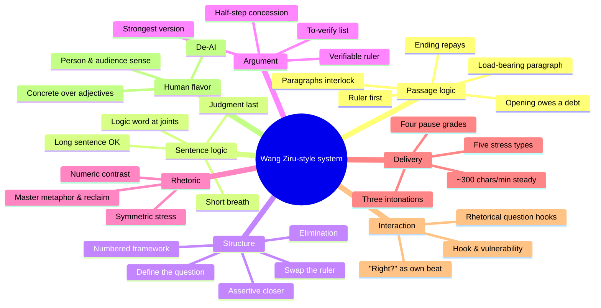

# Wang Ziru-Style Expression Deconstruction (Edition 2) · wangziru-analysis · V2

[简体中文](README.md) · **English**

> Learn the structure, not the accent.

   

> **This is Edition 2 (V2, v1.4 of the original repo) — the data-enhanced edition**: iterated on top of Edition 1 (the original recipe) with more video data — closer to the man himself, but possibly overfitted to the original sample. The entry now works **directly from your own words** — give a topic and it writes a readable script; paste an old draft and it rewrites; ask how to think and it walks the order. For the more general-purpose original recipe, use [wangziru-analysis-skill-v1](https://github.com/chrislitality-svg/wangziru-analysis-skill-v1). Try both.
>
> **这是第二版（V2，对应原仓库 v1.4）——数据加强版**：在第一版（原始配方）的基础上用更多视频数据迭代而成，更像本人，但对原样本可能过拟合；入口改为按用户的话直接写稿、改稿、辅导。想要更通用的原始配方，用 [wangziru-analysis-skill-v1](https://github.com/chrislitality-svg/wangziru-analysis-skill-v1)。两版建议都试试。

An **Agent Skill** for AI coding assistants (Claude Code / Codex / Cursor, etc.). Since v1.4, it does three things directly from your own words: give it a topic and it writes a script you can read aloud; paste an old draft and it rewrites; ask how to think and it explains the thinking order for that topic.

### Recommended Models · 推荐模型

| Priority | Model | Notes |
|---|---|---|
| 🥇 **Primary** | **Gemini 3.8 Flash** | First choice: holds all reference files in one context, stable logic chains, faithful to your wording and facts when rewriting, best value / 首选：长上下文一次读完全部 references，逻辑链排得稳、改稿保留人称与事实 |
| 🥈 **Secondary** | **DeepSeek V4 Flash** | Fallback: native-feel Chinese close to the spoken baseline, stable on 2–3 min shorts, solid with the `tools/` checkers / 次选：中文语感接近口播基准，短口播表现稳定 |

> The skill is a manual; the model you plug in executes it. After switching models, re-run the same topic and audit the output with the five logic questions and `tools/ai_flavor_check.py`.

Argumentative devices are not quotas. If framing, half-step concession, elimination, or metaphor reclaim don't fit this topic, write "none" — never invent targets or numbers just to sound like him. See `SKILL.md` and `references/logic-checks.md`.

The frequency base remains the "Wang Ziru AI" Bilibili corpus of **71 videos** (~**50 hours** of speech). Body text after stripping titles is **864,937 characters**, with "对吧" appearing **1,660 times**. Ignore the earlier figures (796,821 chars, 732k chars, "对吧 1491, 那么 973"). v1.4 additionally read 32 unscripted short monologues, used only to patch social topics and improvised phrasings — not merged into the frequency base.

**Since v1.5 the corpus is open**: the `corpus/` directory ships **32 full transcripts** (with timestamps) — 7 long-form videos from the official channel (Apr–Oct 2026, incl. two brand-new ones) + 25 unscripted improvised shorts from the clip channel JACHZHU (Sep–Oct 2026). The discourse-logic sample grew from 4 videos to 11 long-form + 25 clips. **Anyone can reproduce this repo's numbers or run new quantitative analyses on them**; copyright and usage bounds are in `corpus/README.md` (research/analysis only; no commercial use; no persona mimicry).
**v1.5 起语料开源**：`corpus/` 发布 32 条完整转写（官方号 7 条长片 + JACHZHU 切片 25 条即兴短讲，带时间戳），篇章逻辑样本扩到 11 条正片 + 25 条切片，任何人可复现本仓库的量化分析；版权与使用边界见 `corpus/README.md`。

From [2. Expression Logic](#2-expression-logic) onward, this is the v1.3 research write-up — still valid, but no longer the default workflow. The default entry is `SKILL.md`.

> **Unofficial** · This is an expression-method study, unrelated to Wang Ziru and his team; it does not use his voice or likeness, and scripts it produces must not be signed with his name or pass as his own.

```mermaid
flowchart LR
    IN([Your words]) --> R{What do you want}
    R -- topic --> W[Write<br/>six-line check + body]
    R -- old draft --> E[Rewrite<br/>check where the judgment comes from first]
    R -- how to think --> C[Coach<br/>start with which steps this topic does NOT need]
    W --> L{logic-checks<br/>write "none" if unused}
    E --> L
    C --> L
    L --> OUT([Deliver])
```

**Contents** · [1. Usage](#1-usage) · [2. Expression Logic](#2-expression-logic) · [3. Content Quality](#3-content-quality) · [4. Content Dimensions](#4-content-dimensions) · [5. De-AI-ification](#5-de-ai-ification) · [6. Data Retrospective](#6-data-retrospective) · [Examples](#examples) · [Repo Layout](#repo-layout)

---

## 1. Usage

### Install

**Claude Code** (user-level, available in all projects):

```bash
git clone https://github.com/chrislitality-svg/wangziru-analysis-skill-v2.git ~/.claude/skills/wangziru-analysis
```

Windows PowerShell:

```powershell
git clone https://github.com/chrislitality-svg/wangziru-analysis-skill-v2.git "$env:USERPROFILE\.claude\skills\wangziru-analysis"
```

To use it in one project only, clone it into that project's `.claude/skills/wangziru-analysis/`. **Other tools** (Codex, Cursor, ZCode, etc.): drop the repo into the project and tell the agent "read `wangziru-analysis/SKILL.md` first" — the skill itself is plain Markdown and runtime-agnostic; only the AI-flavor checker needs Python 3.8+ (zero third-party dependencies).

### Four Modes

| Mode | You give it | It gives you | Example |
|---|---|---|---|
| **A Deconstruct** (default) | A topic / question / product / industry phenomenon | A *Deconstruction Blueprint*: definition, ruler-swap correction, elimination, framework, master metaphor, closer line, disclaimer, to-verify list + quality-gate self-check | [Example 01](examples/01-拆解蓝图-AI如何在企业落地.md) |
| **B Write** | A confirmed blueprint, or "just write the script" | **Clean script** (read as-is) + **annotated script** (pauses / stress / intonation) + segment timing table + AI-flavor index | [Example 03](examples/03-成稿-宣传片口播稿.md) |
| **C Audit** | Your existing draft | Draws the logic-chain table first, runs the five logic questions, then names the 1–2 most fatal problems with "old order → new order" and "old sentence → rewritten sentence" pairs | [Example 04](examples/04-成稿-给方法做体检.md) |
| **D De-AI** | An AI-generated draft | Detection report + human-speech rewrite + before/after scores | [Example 02](examples/02-去AI味/README.md) |

### What to Say

| You want | Say this |
|---|---|
| Deconstruct a topic | "用王自如 skill 拆解一下《XXX》，认知正片，10 分钟" (Use the Wang Ziru skill to deconstruct XXX, opinion piece, 10 minutes) |
| Then write | "蓝图可以，接着成稿" (Blueprint approved, now write the script) |
| Short video | "按王自如的方式写一条 90 秒竖屏口播，讲 XXX" (Write a 90-second vertical video script in Wang Ziru's style about XXX) |
| Audit a draft | "帮我体检这篇口播稿：(paste)" (Audit this script for me) |
| De-AI | "这稿子 AI 味太重，改成人话：(paste)" (This draft is too AI-flavored, rewrite it as human speech) |

If you don't give a stance, it picks a **contestable** one for you and says so — no stance, no correction; no correction, no system.

### Results Depend on Your Model

The skill is a manual; the model you plug in executes it. With the same skill, swapping between GPT, Claude, Grok or their variants can change a lot: depth of deconstruction, whether the logic-chain table is right, whether it invents numbers just to sound "concrete".

- **Recommended**: primary **Gemini 3.8 Flash**, secondary **DeepSeek V4 Flash** (see [Recommended Models](#recommended-models--推荐模型) at the top).
- The skill, examples, and the v1.3 logic-chain / long-sentence analysis in this repo were produced with **Claude Opus 5.5** in Claude Code. We have not systematically tested other models and won't judge them.
- Prefer tools that can read files and run Python (Claude Code / Codex / Cursor, etc.): the skill reads a dozen-plus reference files on demand and runs checker scripts. Chat-only environments work too, but you must paste reference files manually and eyeball the checks.
- After switching models, run the same topic as [Example 01](examples/01-拆解蓝图-AI如何在企业落地.md) for comparison, then audit the output with the [logic checklist](#logic-checklist) and `tools/ai_flavor_check.py`. Tell us your model and results in Issues.

### Standalone Checker

```bash
python tools/ai_flavor_check.py draft.txt          # Markdown report
python tools/ai_flavor_check.py draft.txt --json   # for programs
```

---

## 2. Expression Logic

> Sounding like him is the surface; **the order of argument** is what makes this method valuable. We once produced a draft that passed every sentence-level metric (AI-flavor 8, zero certainty words) and was judged "too hollow, all empty talk" — the problem was entirely in the logic. Since v1.3, deconstruction, writing, and auditing all check logic first, on two layers.

### Passage layer: what first, why, how it advances, how it loops back to the opening

From the full transcripts of four signature videos, we extracted the logic chain paragraph by paragraph and distilled four axioms:

| Axiom | What he does | Example |
|---|---|---|
| **The opening owes the audience a debt** | A scene, a contrast, a chain of doubts — the ending must repay | "The Past 48 Days" opens with a meeting where nobody can state the schedule; the ending replays a meeting where one diagram builds 9 schedules |
| **Set the ruler before judging** | Before any "good/bad" appears, the standard is up | "On Thin Phones" first argues you judge by capacity, not thickness, so four phones get one measure |
| **Each paragraph answers the question the previous one left** | Paragraphs interlock as Q&A, not as a list | "Deconstructing Lobster": why viral → the bar dropped → what's new → localization + memory → why banned on mobile but praised on PC → a philosophy of permissions |
| **One paragraph, if deleted, collapses** | The load-bearing paragraph every later judgment derives from | "Deconstructing Lobster": PC admin permissions vs mobile sandbox |

| Advancement skeleton | Order | Fits |
|---|---|---|
| Set the ruler, then measure | Characterize → swap ruler → explain how the ruler measures → deep-dive the benchmark → measure the rest as "responses to the benchmark" → rise to the industry | Corrective reviews, multi-object comparisons |
| Conclusion-first reverse decision chain | Announce the endpoint, air doubts → return to the start → set standards → opportunity appears, tick boxes one by one → pay the price → the author settles the bill in person | Personal narratives |
| Product first, organized by decisions | Pain-point scene → product demo → eliminate alternatives with a difficulty standard → key decisions → cost → replay the opening scene | Retrospectives, showcases |
| Contrast sets the topic, dig layer by layer | Demystify → drop the contrast → chase causes layer by layer → predict → discount the prediction → tiered advice → elevate to method | Hot-take explainers |

**Where cases go**: cases used as proof go **after** the claim; the only things that go before the claim are pain-point scenes, control groups, and product demos, whose job is to set the problem up. **Four kinds of loop closure**: scene replay, debt settled, method upgraded, metaphor reclaimed; not every video closes naturally, so treat it as a mandatory check.

### Sentence layer: he sounds like English because he speaks the logic out loud

Before v1.2 we wrote "median sentence 18 characters, rarely over 30, long ideas become short-sentence waterfalls". **What that measured was breathing, not sentences**: machine transcripts cut at pauses, so we counted each breath as a sentence. Re-segmented by grammar (four signature videos, 234 sentences):

| | One sentence (grammatical) | One breath (between commas) |
|---|---|---|
| Median | **28.5 chars** (argumentative sentences 27–36) | **10 chars** |
| P90 | 59 chars | 20 chars |
| Over 30 chars | **45%** | only 3% exceed 25 |

A sentence takes 3.7 breaths on average. Length doesn't come from long attributives (the rarest of ten structures) but from **clauses chained rightward, one connector word per joint**: 因为/所以 (because/so), 如果…那 (if…then), 只有…才 (only if), 也就是说 (that is), 它/这 (it/this). Across all 71 videos these logic words run **24.9 per 1,000 characters** in his long videos; drafts we wrote under the short-sentence rule only hit ~12 — about half.

| What we wrote under the old rule | Rewritten with long-sentence logic | What chopping short lost |
|---|---|---|
| 大多数人看博主，看的是播放量。这有道理，播放最直观。但它非常片面。(Most people judge creators by view count. Fair enough, views are the most direct. But it's very one-sided.) | 大多数人看博主看的是播放量，这有它的道理，因为播放最直观，但只看播放的话，是非常片面的。 | "因为" marks the reason for the concession; "只看…的话" limits "one-sided" to a condition. The short version said views themselves are one-sided |

Writing rules: **a sentence may be long, a breath must be short** (~10 chars, at most 20); joints must carry a logic word; frameworks and conditions go to the front of the sentence, judgments to the end; long sentences for reasoning, short ones to land the blow. His long sentences are not AI translationese: translationese means long attributives, empty verbs (进行 / 基于 / 实现), noun piles — near zero in his transcripts.

### Logic Checklist

1. What debt did the opening owe the audience? Did the ending repay it?
2. Before the first judgment, was the ruler set?
3. Can every paragraph say "what question of the previous one it answers"?
4. Do proof cases sit right after the claim?
5. Which is the load-bearing paragraph? Does removing it collapse the piece?
6. Sentence layer: are causality, condition, concession *spoken out* with words?

Full method: [`references/logic-表达逻辑.md`](references/logic-表达逻辑.md) (passage layer) · [`references/syntax-长句逻辑.md`](references/syntax-长句逻辑.md) (sentence layer) · Demo: [Example 04](examples/04-成稿-给方法做体检.md) — same topic, three drafts, why the first is empty talk and the second doesn't sound like him.

---

## 3. Content Quality

Quality isn't "feels okay". Blueprint and script share **13 quality gates** (0–12), each verifiable. Gate 0 is checked first; if it fails, nothing after it is looked at:

| # | Gate | How to verify |
|---|---|---|
| **0** | **Logic chain**: the opening's debt is repaid; the ruler precedes judgments; each paragraph can say what it answers; proof cases follow claims; the load-bearing paragraph is identified | Draw the logic-chain table, fill in "why here" per paragraph |
| 1 | Opening 12 s ≤40 chars; "what's this episode about" answerable in 3 s | Count characters; play the opening to a stranger |
| 2 | Definition ≤8 chars; a layperson can retell it in one sentence | Count; have a layperson retell |
| 3 | The B in "not A but B" is **verifiable**; A gets half a step of concession first | Can B be scored / computed / demoed on the spot |
| 4 | Elimination has ≥2 targets, each with a **specific cause of death**, no strawmen | Write "its strongest version" for each target first |
| 5 | Master metaphor reclaimed ≥2 times; no mixed metaphors | Count reclaim points |
| 6 | Framework has 2–4 items, each named ≤6 chars, all parallel | Check whether one item is function and another is feeling |
| 7 | Closer ≤12 chars, contains a number or absolute word, falling tone | Count; can it be clipped into a standalone short |
| 8 | One breath (between commas) ≤20 chars with a logic word at joints; jargon ≤2 uses each, translated on first use | Checker stats on clause length and logic-word density |
| 9 | Disclaimer block configured for format / sponsorship | Against playbook ch. 6 |
| 10 | All data and cases sourced or marked `[待核实]` (to verify) | Drive the list to zero |
| 11 | Elevation grows out of the argument, followed by a real vulnerability point | Delete the elevation; does the argument still stand |
| 12 | **De-AI**: no boilerplate piles, "not-A-but-B" ≤1 per 2,000 chars, certainty words ≤2 per 1,000 chars, no dashes or semicolons | `tools/ai_flavor_check.py` index < 20 |

**A real self-check looks like this** (from the end of the blueprint in [Example 01](examples/01-拆解蓝图-AI如何在企业落地.md)):

| # | Item | Result |
|---|---|---|
| 1 | Opening ≤40 chars, answerable in 3 s | ✅ 33 chars |
| 2 | Definition ≤8 chars, retellable | ✅ 6 chars |
| 7 | Closer ≤12 chars | ✅ 10 chars |
| 10 | Data sourced or marked to-verify | ⚠️ zero out before writing |

### Integrity Red Lines

This expression method has built-in side effects; the skill carries counter-rules:

| Risk | Rule |
|---|---|
| Strawman | For every eliminated option, state its strongest version fairly before the cause of death; no strongest version, no elimination |
| Absolutism | Certainty words ≤2 per 1,000 chars; hammer words only where a mechanism backs them; predictions come with "conditions under which I'd be wrong" |
| Procrustean | Every framework item ships with one real case; no case, cut the item |
| Fabrication | Data, names, events, "I personally tested" stories — you supply them or they get marked `[待核实]` / `[用户补充]` |
| Impersonation | No copying his lines, no signing his name, no "Wang Ziru said" |

---

## 4. Content Dimensions

One script gets deconstructed and checked on eight layers; the first two go first:



| Dimension | What to check | Skill output | Evidence (71-video measurement) | File |
|---|---|---|---|---|
| **Passage logic** | What first, why, how it advances, where cases go, how it loops back | Blueprint §0 logic-chain table | Paragraph-level chains of four signature videos | `logic-表达逻辑.md` |
| **Sentence logic** | Whether reasoning within and between sentences is spoken out | Long-sentence rules + nine skeletons | 234 sentences re-segmented by grammar; logic words 24.9/1k chars | `syntax-长句逻辑.md` |
| **Structure** | Definition, correction, elimination, framework, closer | Blueprint §1–8 | Ten-segment script skeleton | `blueprint-template.md` |
| **Argument** | Is the ruler verifiable; are targets strawmen | Ruler swap + strongest version + cause of death | Mechanism breakdown of the elimination triple | `playbook` ch. 3 |
| **Rhetoric** | One metaphor per video, reclaimed ≥2 times | Master metaphor (tenor → extreme condition → inference) | Metaphor as cross-content IP asset | `strategy` §4 |
| **Delivery** | Where to pause, what to stress, intonation | Annotated script `/ // ///` `【】` `↗↘→` | Pause 0.95 s before "所以" > 0.7 s before "但是"; 70% of stress on numbers and negatives | `playbook` ch. 4 |
| **Interaction** | Confirmation beats, rhetorical hooks | "对吧" ≤15 times, its own beat | "对吧" 1,660 times; 0.9 s pause before, 1.2 s after | `quotes-金句库.md` |
| **Human flavor** | Does it sound like a person talking | AI-flavor report + rewrite | Section 5 below | `de-ai-去AI味.md` |

**Format routing**: opinion piece / personal narrative / hands-on tutorial / podcast conversation / livestream — each gets its own trim template. Speaking rate is estimated at ~300 chars/min steady (measured 303–321 chars/min); pace comes from pauses and editing.

---

## 5. De-AI-ification

> **AI flavor is not a word problem; it's a "no human is talking" problem.** Deleting boilerplate is surface. Human flavor comes from three things: **a stance, concreteness, a sense of audience**.

### Data: in 50 hours of speech, these words barely exist

| High-frequency AI-draft patterns | Measured across 71 videos | What he actually says |
|---|---|---|
| 值得注意的是 / 由此可见 / 换言之 (it's worth noting / hence / in other words) | **0** | Straight to the conclusion, or "I must stress" |
| 至关重要 / 有效地 (crucially / effectively) | **0** | "非常重要 / 最核心", or straight to the consequence |
| 在当今……时代 / 总的来说 / 希望对你有所帮助 (in today's era / in summary / hope this helps) | **0** | Hook opening, closer ending |
| 综上所述 (to sum up) | 1 | "一句话总结" (one-sentence summary) |
| 首先……**其次**……最后 (first... second... finally) | 首先 159, **其次 only 7** | "第一 / 第二 / 第三" (847 / 620 / 206) |
| 一方面……**另一方面** (on one hand... on the other) | 一方面 37, **另一方面 only 2** | Only the side that has something to say |
| 不是 A，而是 B (not A but B) | **0.6 per 10k chars** | Once per video, on the corrective main clause |

Conversely, high-frequency human signals in the speech (per 10k chars):

```
你 (you)        ████████████████████████████████  153.8
我们 (we)       ██████████                         49.1
吗 + 呢         █████████                          41.9
其实 (actually) ███████                            31.6
我觉得 (I think) █████                              22.9
对吧 (right?)   ████                               20.8
那么 (so)       ███                                15.7
```

### Before/after: same topic, AI draft vs skill rewrite

<table>
<tr><th width="50%">Typical AI draft (AI-flavor 73)</th><th width="50%">Skill rewrite (AI-flavor 0)</th></tr>
<tr valign="top"><td>

在当今数字化转型的时代浪潮下，人工智能正以前所未有的速度重塑各行各业。那么，企业究竟该如何让AI真正落地呢？

首先，企业需要明确战略方向。AI落地不是一蹴而就的技术采购，而是一项系统性工程。……

其次，数据是AI的基础。值得注意的是，许多企业的数据分散在不同系统中，形成了数据孤岛。……

总的来说，AI落地是一场马拉松，而不是短跑——它不是技术问题，而是管理问题。……希望本文对你有所帮助！

</td><td>

如果你是老板，你现在最常问的一句话，大概是：哪家的模型最聪明？

这个问题有道理，选错模型确实会翻车。但它非常片面。

你想想，一个顶尖的实习生第一天来上班。没账号，没资料，也没人告诉他做完交给谁。他再聪明，能干出活吗？

所以 AI 落地，我给它的定义就六个字：给 AI 办入职。……

三样没给，再聪明也白搭。

</td></tr>
</table>

| Metric | AI draft | Rewrite | Speech baseline |
|---|---|---|---|
| AI-flavor index | **73** | **0** | original median 10 |
| Boilerplate / empty-word hits | 19 | 0 | — |
| "not-A-but-B" | 3 | 0 | 0.6 per 10k |
| Logic words (per 1k chars) | 11.6 | 31.5 | long videos 24.9 |
| Person words (per 1k chars) | 2.9 | 15.8 | 40.6 |
| Number density (per 1k chars) | 0 | 22.1 | 18.1 |

Full walkthrough (audit → patch blueprint → rewrite → sentence-by-sentence diff) in [Example 02](examples/02-去AI味/README.md).

### Ten AI-flavor Traits

| # | Trait | Spot it | Fix |
|---|---|---|---|
| 1 | Booklish connectives | 首先 / 其次 / 此外 / 值得注意的是 | Number with 第一 / 第二; rhythm from pauses |
| 2 | Symmetric padding | 一方面…另一方面, 不仅…更… | Keep only the side with something to say |
| 3 | "not-A-but-B" abuse | 2+ per piece | Keep 1 per piece; concede half a step to A |
| 4 | Grand empty words | 赋能 / 深度融合 / 时代浪潮 | Replace with actions or numbers |
| 5 | Modifier stacking | 至关重要 / 不可或缺 / 显著 | Cut adjectives; speak in consequences |
| 6 | God's-eye view | "企业应当" throughout | Subject becomes "you"; prefix judgments with "I think" |
| 7 | Stanceless endings | 各有利弊 / 因人而异 | Give the call + conditions to be proven wrong |
| 8 | Booklish punctuation & long clauses | Dashes, semicolons, unbreathable clauses, no logic words at joints | Add 因为 / 所以 / 它 between clauses; don't chop long sentences short |
| 9 | AI-tone openers/closers | 在当今 / 希望对你有所帮助 | Hook opening, closer ending |
| 10 | No specifics | 0 numbers 0 cases | One number or scene per claim; none → mark `[用户补充]` |

**The checker is transparent**: zero dependencies, formulas fully written in the code and [`de-ai-去AI味.md`](references/de-ai-去AI味.md). Calibrated on 71 original transcripts: **median human speech 10 points, 92% below 20**.

**Don't overcorrect**: stuffing "对吧" "其实" into a draft isn't human flavor, it's an accent — exactly what this skill opposes.

---

## 6. Data Retrospective

> After writing the method, we tested it against its own source: all 71 "Wang Ziru AI" videos' transcripts plus public Bilibili engagement data, recomputed together. What held stayed; what didn't was changed. Full version: [`references/data-量化复盘.md`](references/data-量化复盘.md).

**Credibility first**: after removing paid-traffic / campaign videos, only 17 organic long videos remain; none of 140 "language feature × performance" tests survives multiple-comparison correction. Below, measured facts are separated from leads.

### View counts lie

| Fingerprint | Detection rule (within the same format) |
|---|---|
| Paid traffic | Coin rate < 30% of format median, favorite rate < 45%, yet views above median |
| Like campaign | Like-to-coin ratio robust z > 2.2 |
| Share campaign | Share rate > 8× format median |

9 videos (13%) carry fingerprints and take **24%** of views; 8 of 9 tie directly to brands or brand campaigns (Honor, FFALCON, Roewe, Lotus); the last is a WAIC expo podcast with no visible deal. Before benchmarking a creator, run:

```bash
python tools/bili_fingerprint.py BV1xxxx BV1yyyy ...    # or -f bvids.txt, reads public Bilibili API
```

### Topics: saved, or coined

| Topic (organic videos) | Favorites ‰ | Coins ‰ | Audience treats it as |
|---|---|---|---|
| AI & Agents | **10.0** | 7.0 | A tool, saved for later |
| Startup & personal | 5.7 | **8.4** | Support for the person |
| Phones & imaging | 5.0 | 6.5 | News |

So Step 0 gained a question: does this episode want to be **useful** or to be **about the person**.

### Manual claims vs data

| Original claim | Measured | Verdict |
|---|---|---|
| Numbered framework placed at 75–88% | Numbering starts at 5%, ~1.3 sets per 10 min | ❌ changed to a full-length signpost |
| Speech-rate curve: closer drops to 120–150 chars/min | Final cuts run 303–321 chars/min, basically flat | ❌ changed to ~300 chars/min steady |
| Livestream 10–15% faster than final cuts | Livestream ~250 chars/min, ~20% slower | ❌ corrected |
| Master metaphor lands at 15–25% | First appearance median 44% | ❌ no need to front-load |
| "not A but B" on the corrective main clause | Appears in 65% of long videos, ~1 per video, at 22% position | ✅ kept, moved to the first quarter |
| Opening definition at the start | First appearance median 6% | ✅ |
| Position of the elimination | Lexical-marker precision only ~3/8 | ⚪ unmeasurable, unchanged |
| Sentences ≤18 chars, rarely over 30 | 18 chars is the breath; by grammar, median 28.5 chars, 45% over 30 | ❌ wrong measure; changed to long-sentence-short-breath (v1.3) |

Two more leads (p < 0.05, uncorrected): **counterintuitive titles** (不再酷了 / 被高估 / 作秀) get fewer shares, favorites, and coins; **the denser the numbers in the first 60 s, the fewer the coins** — several top-coined episodes open from a scene. Also, his hedging words (可能 / 应该) outnumber certainty words (一定 / 绝对) 2.7-to-1, and more certainty words correlates with fewer coins.

### Rules already fed back into the skill

1. Benchmark only after stripping traffic / campaign fingerprints; watch the coin rate
2. Step 0 asks the value type: save-worthy or coin-worthy
3. Titles carry the experience and conclusion; counterintuition stays in the body
4. Scene hooks rank first in the hook library; numbers come after the scene
5. Numbering is a full-length signpost; "not A but B" once per piece, in the first quarter
6. Certainty words ≤2 per 1,000 chars (the checker flags them)
7. Estimate final cuts at ~300 chars/min steady; pacing via pauses and editing
8. (v1.3) A sentence may be long, a breath must be short, with logic words at the joints

---

## Examples

| Example | Mode | Highlights |
|---|---|---|
| [01 Deconstruction blueprint: how AI lands in enterprises](examples/01-拆解蓝图-AI如何在企业落地.md) | A | 6-char definition "onboard the AI", three non-strawman targets, to-verify list, gate self-check |
| [02 De-AI: auditing and rewriting a typical AI draft](examples/02-去AI味/README.md) | D | 73 → 0, structure before words, five sentence diffs, rerunnable reports |
| [03 Final script: promo video voice-over](examples/03-成稿-宣传片口播稿.md) | B | 28 sentences mapped to the skeleton, clean + annotated scripts, "not-A-but-B" used once |
| [04 Same topic, three drafts: why the first is empty talk](examples/04-成稿-给方法做体检.md) | B + C | All three pass sentence metrics; the difference is all logic. Includes logic-chain table, annotated script, fact checks |

## Repo Layout

```
SKILL.md                              Entry: write / rewrite / coach directly from your words, logic-checks, red lines
references/
  logic-checks.md                     Device checklist: use only what this topic needs; write "none" otherwise
  audit_and_rewrite.md                Rewrite: keep your person and facts, don't invent numbers
  coaching_framework.md               Coach: start with which steps this topic does NOT need
  logic-表达逻辑.md                    Passage layer: four axioms, four skeletons, case placement, loop closure, chain table
  syntax-长句逻辑.md                   Sentence layer: long sentence OK / short breath, nine skeletons, vs AI translationese
  blueprint-template.md               Blueprint format, opening hook library, format routing, full example
  playbook-句法手册.md                 Ten-segment skeleton, seven weapons of syntax, pause/stress notation, vocab swaps, building blocks, training plan
  banned_and_myths.md                 Claims with real count 0 that must not enter scripts (v1.4)
  building_blocks.md                  Building blocks for direct writing (v1.4)
  sentence_variants.md                Sentence variants (v1.4)
  pause_and_syntax.md                 Three pause grades with slashes; 18-char rule as breath guidance only (v1.4)
  de-ai-去AI味.md                      Ten AI-flavor traits, 71-video baselines, rewrite order, checker formulas
  data-量化复盘.md                     Testing the skill against 71 videos: confirmed / falsified rules, topic value types, title leads
  quotes-金句库.md                     Rhythm exemplars per sentence type (with stress / pause notation)
  samples-标杆拆解.md                  Minute-level structural breakdowns of two benchmark videos
  strategy-内容战略与局限.md            Topic planning, serialization, and what this method cannot explain
tools/
  ai_flavor_check.py                  AI-flavor checker (zero deps, Python 3.8+)
  bili_fingerprint.py                 Bilibili traffic / campaign fingerprint checker (zero deps, public API)
examples/                             Four full cases (deconstruction / de-AI / final script / three-draft logic comparison)
CHANGELOG.md                          Release notes
```

## About Quotations

The few original-line quotations in `references/` (mostly in `quotes-金句库.md`, each labeled with source video and timestamp) come from machine transcriptions of Wang Ziru's public videos. **Copyright belongs to the original author**; they are used solely for analysis and commentary of the expression method. Word-frequency statistics were computed read-only from per-video transcripts. The raw full-text corpus is not distributed with this repo. If the original author objects, open an Issue and I'll remove or amend immediately.

## License

[CC BY-NC 4.0](LICENSE): free to use, modify, and redistribute with attribution; commercial use prohibited. The original-line quotations covered by "About Quotations" are outside this license.
