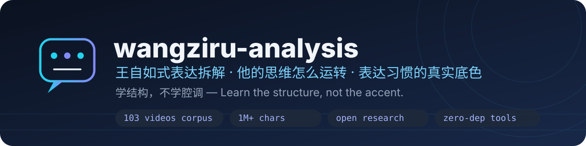
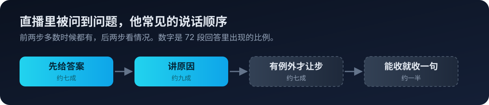

<div align="center">



# 왕쯔루(王自如) 표현 분석 (제2판) · wangziru-analysis · V2

**구조를 배우고, 억양을 흉내내지 않는다 — 그의 사고가 어떻게 굴러가는지를 연구합니다.**

[](CHANGELOG.md)
[](LICENSE)
[](.github/workflows/ci.yml)
[](tools/)
[](corpus/)
[](CONTRIBUTING.md)

[](https://github.com/chrislitality-svg/wangziru-analysis-skill-v2/stargazers)
[](https://github.com/chrislitality-svg/wangziru-analysis-skill-v2/network/members)

[简体中文](README.md) · [English](README.en.md) · **한국어** · [日本語](README.ja.md) · [Français](README.fr.md) · [Deutsch](README.de.md)

</div>

> **제2판(V2) — 데이터 강화판**: 제1판(오리지널 레시피) 위에 더 많은 영상 데이터를 얹어 발전시킨 버전으로, 본인에 더 가깝지만 원본 표본에 과적합되었을 수 있습니다. 더 범용적인 오리지널 레시피(청사진 우선 워크플로)는 [wangziru-analysis-skill-v1](https://github.com/chrislitality-svg/wangziru-analysis-skill-v1)을 사용하세요. 두 버전을 모두 써보시길 권합니다.

---

## 이 저장소는 무엇인가

**이 저장소는 먼저 연구 프로젝트입니다: 왕쯔루의 사고가 실제로 어떻게 작동하는지, 그의 표현 습관은 무엇인지.** AI 코딩 어시스턴트용 Agent Skill(`SKILL.md` — 작성 / 수정 / 코칭)는 그 연구 결론을 실행 가능하게 요약한 제품 레이어입니다. 연구 입구는 [`references/thinking-思维运转.md`](references/thinking-思维运转.md)(모든 결론에 코퍼스 출처와 타임스탬프가 붙음), 제품 입구는 `SKILL.md`이며, 어떤 결론이 측정된 사실이고 어떤 것이 번역된 작성 규칙인지는 [`METHODOLOGY.md`](METHODOLOGY.md) §9의 증거 등급표에서 확인할 수 있습니다.

### 핵심 발견: 그의 사고는 어떻게 굴러가는가

1. **판단이 언어에 앞선다.** 즉흥 질문을 받으면 판정이 첫 박자에 지연 없이 떨어지고("휴대폰 업계에 미래가 있나? — 없어."), 언어가 그 뒤에 보태는 것은 언제나 메커니즘이지 형용사가 아니다. 대본 있는 영상에서는 순서가 뒤집힌다(증거 먼저, 판단 나중). 하나의 두뇌, 두 가지 출력 — 판단은 미리 만들어진 것이지 현장 추론이 아니다.
2. **자(尺子)는 재고다.** 판단은 영상을 가로지러 호출되는 장기 기준 라이브러리에서 나온다(화웨이 영상이 아이폰18 영상의 3격자 자를 직접 재사용). 기준은 수사의문문 형태로 나타나기도 한다.
3. **양보는 명시적이다.** 망설임의 분기들을 소리 내어 말하고, 하나를 고르고, 자기 판단임을 표시한다("我觉得" 만자당 6.5회; 헤지 단어가 확신 단어보다 항상 ~2.7배 많다 — 확신은 정의와 번호 매기기에서 나오지 "분명히/절대적으로"에서 나오지 않는다).
4. **마무리 문장은 저장 형식이다.** 모든 추론 사슬의 끝에서 판단을 인용 가능한 한 문장으로 주조한다("침에 빠져 죽은 회사는 없다").
5. **입버릇은 사라지고 있다.** "对吧"는 71영상 기반의 만자당 20.8회에서 2026년 코퍼스의 3.7회로 떨어졌다 — 그의 입버릇을 흉내내는 것은 그가 버리고 있는 부분을 흉내내는 것이다. 그의 연속성은 작동 순서에 있지 어떤 단일 단어에 있지 않다.

<div align="center">

</div>

### 추천 모델

| 우선순위 | 모델 | 비고 |
|---|---|---|
| 🥇 **1순위** | **Gemini 3.8 Flash** | 모든 reference 파일을 한 컨텍스트에 담을 수 있는 긴 컨텍스트, 안정적인 논리 사슬, 수정 시 원문 인칭·사실 보존, 최고의 가성비 |
| 🥈 **2순위** | **DeepSeek V4 Flash** | 대안: 구어 기준에 가까운 중국어 감각, 2–3분 짧은 구술에서 안정적, `tools/` 검사기와의 호환성 견고 |

## 30초 시작하기

의존성 불필요 — 그의 실제 발화로 AI맛(AI 味) 검사기를 체험해 보세요:

```bash
git clone https://github.com/chrislitality-svg/wangziru-analysis-skill-v2.git
cd wangziru-analysis-skill-v2

# 그의 실제 구술(2026-09 라이브 클립)로 검사: AI맛 ≈ 11 예상 (사람 말 등급)
python tools/ai_flavor_check.py "corpus/clips-jachzhu/2026-09-22-聊西贝事件的根源-1m11s.txt"

# AI 생성 초안을 넣으면 점수가 70+로 뛴다 — 그 격차가 이 연구가 설명하는 것이다
python tools/ai_flavor_check.py draft.txt --json
```

AI 코딩 어시스턴트(Claude Code / Codex / Cursor 등)에 스킬 설치: `git clone https://github.com/chrislitality-svg/wangziru-analysis-skill-v2.git ~/.claude/skills/wangziru-analysis`

> **비공식** · 본 저장소는 표현 방법 연구로 왕쯔루 본인 및 그 팀과 무관합니다. 그의 목소리나 초상을 사용하지 않으며, 산출물에 그의 이름을 서명하거나 본인을 사칭해서는 안 됩니다.

## 코퍼스와 방법론

- **코퍼스**: 빌리빌리 '왕쯔루AI' 채널 **71개 영상**(약 50시간, 864,937자) + 2026-04~10월 공식 장편 7개·서드파티 클립 25개 등 **32개 전문 전사(轉寫) 오픈 공개**(`corpus/`, 타임스탬프 포함). 누구나 이 저장소의 숫자를 재현할 수 있습니다.
- **방법론**: 질적 부호화(질문-대답 사슬) 중심 + 어빈도는 검증 전용. 샘플링·채집·전사 명령·복현 가이드는 [`METHODOLOGY.md`](METHODOLOGY.md), 연구 과정 원본 기록은 `research/`에 공개.

## 커뮤니티

- **기여하기**: 결론 재현·반박, 새 코퍼스 부호화, 즉흥 레이어 표본 편향 검증(최우선 과제), 번역 — [기여 가이드](CONTRIBUTING.md) / [행동 강령](CODE_OF_CONDUCT.md)
- **자매 저장소**: [wangziru-analysis-skill-v1](https://github.com/chrislitality-svg/wangziru-analysis-skill-v1) (제1판 · 오리지널 레시피 · 청사진 워크플로)

<div align="center">

[](https://star-history.com/#chrislitality-svg/wangziru-analysis-skill-v2&Date)

이 연구가 도움이 되었다면 Star 부탁드립니다 ⭐

</div>

## 라이선스

[CC BY-NC 4.0](LICENSE): 출처 표시와 함께 자유롭게 사용·수정·재배포 가능, 상업적 사용 금지. 원문 인용은 이 라이선스 범위 밖입니다. 상세한 연구 문서(중국어·영어)는 [README.md](README.md) / [README.en.md](README.en.md)를 참고하세요.
